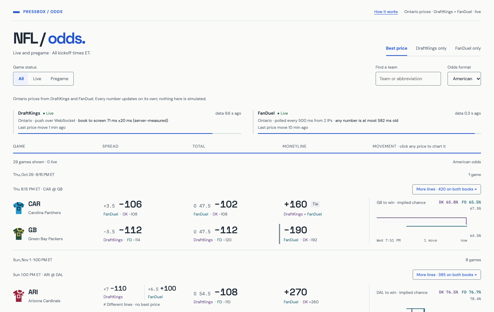

# NFL Odds Board — DraftKings vs FanDuel

**Live:** https://nfl-odds-board-hgim.onrender.com · **Code:** https://github.com/youngbizman/nfl-odds-board

A side-by-side NFL board (moneyline, spread, total; pregame and in-game) that pulls from DraftKings and FanDuel,
normalizes both into one model, shows the best price with the book underneath, and pushes every line move to the
browser without a refresh. Toggle at the top: **Best price / DraftKings only / FanDuel only**.
Also **college football and the CFL** from the same two books: *League* switch on the page.

**Plain addresses**, like any well-made site: `/` (NFL), `/college-football`, `/cfl`, `/all`, and each game at its own
page, e.g. `/nfl/cardinals-at-cowboys-2026-11-01` (league, the two teams, the day in Toronto). Back and Forward work;
the tab title names the league or the game. Display choices are the only query: `?design=engineering`, `?theme=dark`,
`?view=fanduel`, `?range=1d` (a game's chart). No `#` fragments; older links (`?league=`, `?game=`) land on the plain
address; `/nfl` and trailing slashes redirect; anything else is a real 404.



What is on the page, beyond the board itself:
* **Three leagues** — NFL, college football (NCAAF) and CFL, same rules and same live updates; each viewer's stream
  carries only the league on screen (§3, "Other leagues").
* **More lines** on every game — alternate spreads and totals, anytime touchdown scorer, and passing / rushing /
  receiving yards and receptions milestones (e.g. "Josh Allen 250+ passing yards"), both books side by side, best
  price only where both books offer the exact same line and player (§3, "More lines").
* **A movement chart** per game in the space beside the prices: each book's implied chance over the last 48 h (a live
  game: since kickoff). Click any price to chart it. History is one point per real change, kept in Redis across restarts.
* **Who wins, at a glance** — the winning cell takes the winning book's colour (DraftKings purple, FanDuel teal) and
  shows the edge in cents (`+8¢`: −192 vs −200).
* **Hold and arbitrage** — every game shows the hold per market at the best price on each side (either book), and a
  *Tightest markets* strip shows the **3** lowest holds (*Show more* opens up to 9, *Show fewer* goes back to 3), game
  lines and alt lines, in the same games the board shows (league, *Show*, search; the recent moves follow the same set).
  On the page it is called **margin**: what the books keep if you bet both sides at the best prices. Below 0% the two
  prices together pay back more than the stakes, a possible arbitrage at the prices shown (flagged). Click one to jump
  to the game. (`bestHold()` in `src/model.js`, tested.)
* **Star games** to pin them to the top (kept in this browser). **Dark mode** is a switch (☾, or `d`); the page always opens light unless the link
  says `?theme=dark`. The feed status shows each book's state (*Connected* / stale / reconnecting), last message and
  freshness bar at first sight (Engineering also shows the last full snapshot); *Details* opens the rest (how it is read,
  measured latency, last price move). Kickoff countdowns on every slot.
* **Keyboard:** `/` find a team · `1 2 3` best / DraftKings / FanDuel · `d` dark · `s` star the focused
  game · `Enter` chart the focused price · `?` help.
* **The wire** — the latest price and line changes as they happen (old → new, which book, how long ago).
* **A moved price stands out** — a strong green/red flash, then for 8 s a thick green (odds up) or red (odds down) bar,
  a tint, and the old price on a pill beside the new one, in both designs and both colour schemes.
* **Every game has its own page** — click the matchup, or click its chart ("Open full chart"): a big chart of each
  book's implied chance with **10 min / 1 hour / 6 hours / 1 day / 1 week / All** windows (only windows the board has
  history for can be picked; a live game opens on the last hour, a game not started on the last day), any of the six
  prices, **point at the chart to read both books' exact prices at that moment**, a strip showing which spread/total line
  each book had up, its alt lines and props, and the moves in that game. Busy live charts drop the per-change dots so
  the lines stay readable. It has its own address (`/nfl/cardinals-at-cowboys-2026-11-01`), so it can be shared; Esc or Back returns.
* **More lines has a chart beside the table** — each book's chance at every alt spread / total / yardage threshold
  (ringed where that book pays more), or a bar per player for anytime touchdowns.
* **Per-book feed cards** — how the book is read (push, poll, or both); **latency, measured only** — the book's own
  stamp → our server, and → *this page* (received) and → drawn on screen, each a median with its sample count, when the
  last sample came and how far the clocks can be off (nothing is filled in with a guess: no samples = "measured on
  the next price move"); **last heard**, how long since the book last sent anything (DraftKings only sends when a price
  changes, plus a connection check every 10 s, so on a quiet day this counts up to ~10 s — it is proof of life, not a
  delay); **last price move**; and a freshness bar that drains as that silence approaches the stale limit.
* **Stale handling** — a book that stops answering turns red, its prices grey out, a banner says so; the other book
  keeps moving. Lost server connection → "reconnecting" banner, then a fresh snapshot. A stream that dies *silently*
  (the connection stays open but nothing arrives — seen on a home network where HTTP/3 kept timing out) is caught too:
  the server speaks at least every 5 s, so after 12 s of silence the page greys every price, says "reconnecting" and
  opens a fresh stream (`tools/stall-check.mjs` pauses the server: noticed in 12.0 s, recovered 1 s after it resumed).
* Games grouped by kickoff slot, live games first; the single-book views show "updated N s ago" on every number.
* Team search, Live/Pregame filter, American or decimal odds (decimal to 3 places so −340 vs −350 stays visible).
* **Two designs, one switch, one top bar.** Both designs share the same header (`public/topbar.js`): name, design
  switch, how it works, light/dark, help; the league title with *Best price / DraftKings only / FanDuel only* beside it;
  then League · Show (all / live / pregame / starred) · Find a team · Odds, in the same place with the same words. *Design* is shareable as `?design=engineering` (Comfortable is the default):
  * **Comfortable** — the readable board described above.
  * **Grid (engineering)** — everything on one screen, spreadsheet-dense: each game is two rows; *Best available*,
    *DraftKings* and *FanDuel* columns side by side (the best cell in dark, the winning book's cell starred, the edge in
    cents); per row the **no-vig fair win %** (both books de-vigged on the same line and averaged) and the **EV** of the
    best price against it; per game the **hold** per market and a 48 h sparkline; sortable by kickoff, hold or EV; feed
    health (state, mode, data age, latency, freshness), tightest markets and the wire in panels on top; alt lines and
    props open as a row inside the table. Numbers in aligned columns, colour only where it means something; light and dark.
  Both designs use one calm typeface (Inter) with digits that line up. Every design only draws; the rules (which price wins, what is stale, fair line, hold) live in one tested place, so
  switching design can never change a number.

The scraping is read-only and login-free: the same public odds endpoints the sites' own pages call, at or below
the rate the pages themselves use, one connection per book.

---

## 1. Run it locally

```bash
git clone https://github.com/youngbizman/nfl-odds-board && cd nfl-odds-board
npm ci
npm start            # http://localhost:3000
```
Node ≥ 20, no database, no keys. Settings are environment variables (see `.env.example`); defaults work from a
residential IP in Ontario (DraftKings Ontario site) and anywhere for FanDuel. On a cloud server DraftKings' snapshot
host refuses Node's HTTPS client; `INSTALL_CURL_TRANSPORT=1 npm ci` (automatic on Render) adds a small Python venv with
`curl_cffi`, which the server switches to by itself after the first 403 (§6).

Useful endpoints: `/api/board` (full JSON snapshot) · `/api/stream` (SSE) · `/api/metrics` (latency counters) ·
`/api/diag/draftkings` (what DK says to *this* server's IP) · `/healthz`.

Optional fallback, only needed if DraftKings ever refuses both clients: run the snapshot provider from a machine DK
accepts and point it at the server (the server ignores it while its own snapshots work):
```bash
CLOUD_URL=https://your-server INGEST_TOKEN=<same value as on the server> npm run edge
```

## 2. Architecture

```mermaid
flowchart LR
  subgraph books
    DK[(DraftKings)]
    FD[(FanDuel)]
  end
  subgraph ingestion["one worker per book"]
    DKW["DraftKings worker<br/>snapshot (REST, browser-compatible client) + deltas (WebSocket, JSON)"]
    FDW["FanDuel worker<br/>push (AppSync WebSocket) + poll getMarketPrices every 1 s<br/>(≤ 50 markets per request, in parallel)"]
  end
  STORE["BoardStore (in memory)<br/>games · quotes · per-book status<br/>emits only real changes"]
  REDIS[("Redis<br/>dk:state checkpoint<br/>dk:frames stream")]
  DKW <-. "checkpoint 60 s + every frame (XADD); restore on boot" .-> REDIS
  SSE["SSE fan-out<br/>one event per upstream message, no wait"]
  B1[browser]:::b
  B2[browser]:::b
  B3[browser …]:::b
  DK -- "wss (push)" --> DKW
  FD -- "wss (push) + https (pull)" --> FDW
  DKW --> STORE
  FDW --> STORE
  STORE --> SSE
  SSE --> B1 & B2 & B3
  EDGE["optional edge (src/edge.js), another IP<br/>fallback DK snapshots · FanDuel poll half a beat after ours"] -. "only if DK refuses the cloud" .-> DKW
  EDGE -. "FanDuel markets that changed" .-> FDW
  classDef b fill:#223,stroke:#669
```



* `src/sources/draftkings.js`, `src/sources/fanduel.js` (+ `fanduel-push.js`) — one ingestion per book, never per viewer.
* `src/transport/` — HTTPS for DraftKings' snapshot host: Node first, then one long-lived browser-compatible worker
  (`curl_worker.py`, curl_cffi with Chrome's TLS/HTTP2 handshake) after the first 403.
* `src/store.js` — the single normalized board. `upsertQuote` only emits when price/line actually changed, so idle
  polls cost nothing downstream.
* `src/server.js` — static UI, `/api/board` snapshot, `/api/stream` SSE, metrics, edge ingestion.
* `src/model.js` — canonical teams, game key, odds helpers, **best-price policy**.
* `public/app.js` — the board core: one `EventSource`, settings, filters, latency measurement. It ranks prices with
  the **same `compare()` from `src/model.js`** the tests check (served as `/lib/model.js`), so the page cannot disagree
  with the tests. `public/themes/` — the designs; a theme gets data and helpers and only renders.
* `tools/` — the research tooling: `capture-network.mjs` (records what each book's page really does),
  `probe-*.mjs`, `measure-latency.mjs`. Findings in [`research/findings.md`](research/findings.md).

A third book = one more file in `src/sources/` that writes `Game`/`Quote` objects into the store. Nothing else changes
(the UI reads books from the data). See §11.

## 3. How I get data from each book, and why

I did what the brief suggests: opened each site with a real Chrome under Playwright and recorded every request and
WebSocket frame (`npm run capture -- <url> <dir> <seconds>`). The two books are opposites.

### DraftKings — snapshot + WebSocket deltas (push)
1. `GET sportsbook-nash.draftkings.com/sites/<REGION>/api/sportscontent/controldata/league/leagueSubcategory/v1/markets?…league 88808 (NFL), subcategory 4518 (Game Lines)…`
   → `{events, markets, selections}` ≈ 155 KB in ~300 ms. That is the whole board.
2. `wss://sportsbook-ws-<region>.draftkings.com/websocket?format=json` — JSON-RPC 2.0. (The site itself asks for
   `format=msgpack`; the same server speaks JSON.) One `subscribe` with the same OData filters and `initialData:false`;
   the server answers `subscribed` and then pushes **only changes**: `{add, change, remove} × {events, markets,
   selections}`, each frame stamped with DK's own `createdTime / publishedTime`. `jwt: "default-token"` — no login,
   nothing expires. A line move arrives as `remove(old id) + add(new id with points)`; a price move as a partial
   `change` on the selection.

**Why:** it is literally the fastest path the DK site uses; nothing to poll, and every push carries a source timestamp,
which makes true end-to-end latency measurable. I started with the msgpack frames (positional arrays decoded by shape)
and moved to the JSON form once I confirmed the server honours it: structured frames, no guessing.

### FanDuel — snapshot + push (AppSync), with polling as the safety net
1. `GET sbapi.on.sportsbook.fanduel.ca/api/content-managed-page?page=CUSTOM&customPageId=nfl&_ak=<public app key>`
   with `x-sportsbook-region: ON` → ≈ 1.5 MB (includes futures and props I ignore). That is the whole page model.
2. **Push:** `wss://pir.on.sportsbook.fanduel.ca/graphql/realtime` — AWS AppSync, GraphQL subscription
   `onUpdateMarketPrice(ids)`. Each message is one market's full price picture (runners, handicaps, odds, status) the
   moment FanDuel changes it, stamped with FanDuel's `updatedAt`. The connection is authorised with the web app's
   public client id, which the server reads at start-up from the app's own bundle (`sw.js` names it), so a FanDuel
   deploy that rotates it costs a reconnect, not a code change. No login, no cookies.
3. **Poll:** `POST smp.on.sportsbook.fanduel.ca/api/sports/fixedodds/readonly/v1/getMarketPrices  {marketIds:[…]}`
   → fresh prices/handicaps for those markets. FanDuel's own widgets poll this about every 5 s.

My first recordings only showed the polling, so the first version polled; I found the subscription later and added
it. **Why both — measured, not assumed:** on Thursday afternoon (pregame) the push delivered only about **1 in 7** of
FanDuel's price changes first; polling caught the rest (`byLeague` in `/api/metrics` counts which channel delivered
each change first, per league). So polling is not just a safety net: it is half the feed, and it stays at **1 s** for
every NFL market and for every *live* college or CFL game; the push adds speed wherever FanDuel fires it. Every market remembers the time of the newest answer applied to it (a push counts
from when it arrived, a poll from when it *started*), so an older answer can never overwrite a newer one. The full page
(step 1, re-read every few minutes) only discovers games and markets and seeds prices: it never overwrites a price the
poll or push answered after the page was requested or in the last 30 s, and a market FanDuel marks `SUSPENDED` greys
every price in it even when its runners still say `ACTIVE` (both tested). Outside the NFL, pregame markets are polled
in turn, one batch per beat (each about every 8 s); the feed panel says so for the league on screen.
**FanDuel answers at most 80 markets per request and silently drops the rest** — with 87 game-line markets, one
request left 7 markets un-refreshed. Polling now splits them into the fewest requests of ≤ 50 (`FD_CHUNK`), sent in
parallel, each applied the moment it lands; the page reports `returned/requested` so a cap can't hide again
(live: **87/87 markets in 2 parallel requests, 52 ms**). If
FanDuel answers 429/403/5xx the interval doubles (honouring `Retry-After`) up to 30 s and recovers by itself; if the
push drops, it reconnects with backoff (1 → 30 s) and re-subscribes, while polling carries on.
With the optional edge machine (§6) running, a second poller on another IP polls half a beat after ours, so a fresh
polled answer lands every ~0.5 s even at one request per second per IP.

### More lines: alternate lines and player props, both books
Found the same way (recording each book's game pages tab by tab):

| | DraftKings | FanDuel |
| --- | --- | --- |
| Where | league-level subcategories: 13195 alt spread, 13196 alt total, 12438 TD scorers, 16569/16571/16570 passing/rushing/receiving yards milestones, 16821 receptions milestones | only on each game's own page: `api/event-page?eventId=…&tab=popular` → `ALTERNATE_HANDICAP`, `ALTERNATE_TOTAL`, `ANY_TIME_TOUCHDOWN_SCORER`, `PLAYER_X_ALT_{PASSING,RUSHING,RECEIVING}_YARDS_*`, `PLAYER_X_ALT_RECEPTIONS_*` |
| Snapshot | same REST as game lines (same browser-compatible client), one subcategory at a time, each every ~2 min | one game page per game every 10 min, from the cloud |
| Updates | its **own** push socket, one subscription per subcategory | `getMarketPrices`, 50 markets per request, at most one request a second: every **3 s** for games someone has open, every 60 s otherwise; pauses itself 5 min on 403/429 so it can never cost the main board its rate budget |

Matching: an alt line is (game, side, number); a prop is (game, player, threshold). DraftKings sells yardage as
milestones ("250+") and so does FanDuel's "alt" ladder ("Josh Allen 250+ Yards"), so they compare exactly where the
thresholds coincide (DK 250+ vs FD 250+); DK 260+ or FD 275+ are shown for that book only, never ranked. Players are
matched on a normalised name ("Kenneth Walker III" = "Kenneth Walker", "D.J. Moore" = "DJ Moore"). DraftKings' 1st-TD
and 2+ TD markets live in the same subcategory and are filtered out. Ranking uses the same `compare()` as the board.
Everything sits in its own store, workers and **one stream per open game** (`/api/extras/stream?game=`), so ~7,500
prop prices never touch the main board's stream. Checked live (`tools/check-extras.mjs`): BAL@BUF and KC@DEN, every
price on the board identical to what each book served at that moment (2,001 prices, 0 different, 0 missing), with
801 bets priced by both books.

### Other leagues: college football and the CFL
Both books serve every football league through the same endpoints and the same market shapes; only the league id
changes (DraftKings `leagueId` 88808 NFL, 87637 NCAAF, 33567 CFL, subcategory 4518 "Game Lines" for all three;
FanDuel `customPageId` nfl / ncaaf / cfl). Found by recording each league's page, as for the NFL. One worker per book
still: DraftKings fetches one snapshot per league and opens one subscription per league on the same socket; FanDuel loads
one page per league and puts every market on the push. `LEAGUES=nfl,ncaaf,cfl` (default) chooses them; NFL is always on.
* **Matching teams.** CFL works like the NFL (nine unique nicknames: "SSK Roughriders" = "Saskatchewan Roughriders").
  College has 130+ schools and neither book uses nicknames, but both write the school name the same way ~95% of the
  time; a short alias list covers the rest ("Miami FL" = "Miami Florida", "UConn" = "Connecticut", "ULM" = "UL Monroe").
  Checked on Oct 29: 58 of DraftKings' 65 college games found their FanDuel twin; the other 7 are next week's games
  FanDuel had not posted yet.
* **Kept apart.** Each league's snapshot can only remove that league's prices. NFL game keys are unchanged
  (`CAR@GB:2026-10-29`), other leagues are prefixed (`ncaaf:troy@james-madison:2026-10-29`, `cfl:WPG@TOR:2026-10-31`),
  so stored history still matches. `/api/stream?league=`, `/api/board?league=` and `/api/history?league=` send only
  that league, so the NFL page is not slowed by ~1,400 college prices; `league=all` sends every league.
* **All leagues on one board.** The League switch has **All**: one stream with every league, the board split into an
  NFL section, a college section and a CFL section, each with its own live games first and then its kickoff slots;
  the Live / Pregame / Starred filters work inside it the same way.
* **Polling budget.** The NFL and every live college or CFL game are polled every beat (1 s); the other leagues'
  pregame markets (~360) take turns, one batch of ≤ 50 per beat, so each is re-read every ~8 s (pregame lines move
  slowly; the push adds what it catches). That keeps FanDuel at about 3 requests a second when no college game is live.
* **Checked live** (`tools/check-leagues.mjs`, Thu Oct 29): every college and CFL price on the board against what each
  book's own API served at that moment, matched by the book's own event id: college **DraftKings 390/390, FanDuel
  713/713** identical; CFL **12/12** and **12/12**; 0 different, 0 missing. 126 college games and 2 CFL games on the board.
* **Small schools.** Our DraftKings college collector covers its FBS league; FanDuel's college page also lists ~50 FCS
  games, so those have one book only. With nothing to compare they are hidden by default in college, and one click shows them ("only available offer"). Alt lines and player props stay NFL-only.

### Same jurisdiction for both books: Ontario
Both books run a separate site per jurisdiction, and prices can differ between them. DraftKings only lets us in from
Ontario (§6), so the board uses **Ontario for both books**: DraftKings `CA-ON-SB` and FanDuel Ontario
(`on.sportsbook.fanduel.ca`, region `ON`). I found this the hard way: the brief's FanDuel link
(`sportsbook.fanduel.com`) opened from Toronto serves **New Jersey** prices, so my first version compared DK Ontario
with FD New Jersey. On Oct 28 FanDuel NJ and ON happened to be identical (174/174), but they are separate markets with
separate ids and can diverge. Each book's region is shown on the page.
**Ontario is enforced, not just the default:** every DraftKings snapshot URL, socket subscription (`siteName dkcaon`),
restored checkpoint and edge snapshot must be `CA-ON-SB`, and FanDuel is always region `ON`. A different `DK_SITE` /
`FD_REGION` setting is ignored with a log line; a checkpoint or edge snapshot from another site is refused (counted in
`edgeRefused`). If Ontario's snapshot host refuses the server, the page says so and waits for an Ontario snapshot;
it never fills the board from another region's prices.

## 4. Snapshots vs deltas — who keeps the state

| | DraftKings | FanDuel |
| --- | --- | --- |
| Feed type | **deltas** (changes only) | push: **one whole market** per change · poll: **full picture** |
| State kept by | **us**: snapshot into the store, apply each delta by selection id | nobody: each pushed market and each poll is authoritative for its markets (newest wins) |
| Safety net | line moves applied from the push itself (`remove`+`add`); full re-snapshot every 30 s, 3 s after a push names an id we cannot place, and after every reconnect | polling every 1 s under the push; full re-snapshot every 60 s (new games, markets going in-play) |
| Quiet ≠ dead | ping/pong every 10 s; no pong in 10 s → reconnect (backoff 1 → 30 s) | push: AppSync keep-alives, silence past the advertised timeout → reconnect; poll: a failed/slow poll is visible immediately |

## 5. Push to the browser

* **SSE (`EventSource`)**, not WebSocket: the browser only listens; SSE is plain HTTP, auto-reconnects, and passes every
  proxy. On connect the client gets one `snapshot` event (~90 KB for 29 games / 348 prices), then `batch` events.
* **No timer batching.** Everything one upstream message changes (one DK frame, one FD poll) is applied synchronously,
  so a `setImmediate` flush already groups it into one event without adding delay. Measured wait before sending:
  **p50 0 ms, p95 1 ms** (it was a fixed 40 ms window in the first version). A typical event is 1–2 prices, ~300 bytes,
  written with Nagle off. Full status rides a 5 s heartbeat; the moment a poll or frame lands, a tiny `beat` event
  (two timestamps per book, at most 4 per second) keeps "data 0.4 s ago" exact instead of up to 5 s late.
* Adding viewers adds zero requests to the books: one ingestion, N listeners. The ~100 KB snapshot is serialised once
  per board change, not once per viewer.
* **Many viewers, measured** (`node tools/load-sse.mjs <url> 500 60 25`, from one laptop against the free Render
  instance, 0.1 CPU): 500 concurrent viewers, 0 errors; updates delivered **p50 75 ms, p95 354 ms** after the server
  stamped them; joining at 25 viewers/s, time-to-snapshot p50 0.4 s. All 500 joining in the same second queued up to
  ~14 s for their snapshot (CPU + one home uplink receiving 50 MB) — the first thing a paid instance, gzip on the
  snapshot, or a CDN in front would fix.

## 6. What I hit (geo, bot protection, rate limits) — and what I did

| | DraftKings | FanDuel |
| --- | --- | --- |
| Bot protection | **Akamai.** Headless Chromium → 403 on the HTML page. The old public API (`/sites/US-SB/api/v5/eventgroups/88808`) → 403. **Node's HTTPS client from a datacenter IP → 403 on the data API** (AWS Ohio, reference ids in `/api/diag/draftkings`), while the HTML page still returns 200 from the same IP; a client with Chrome's TLS/HTTP2 handshake (curl_cffi) from the same IP → 200. Real Chrome and plain Node from a residential IP pass with the site's own `x-client-*`/`referer` headers. | **PerimeterX** (`_px3` token on API calls). Plain Node *without* the token gets 200 from a residential IP **and** from AWS Ohio (15 ms per poll — FD's API lives next door). |
| Geo | **Fenced by IP per licensed region.** From Ontario only `CA-ON-SB` answers; `US-NJ-SB`, `US-OH-SB`, `US-SB` → 403, and vice-versa. The worker only ever asks for `CA-ON-SB`. | Not fenced for reading odds: both the Ontario (`.ca`, `ON`) and New Jersey (`.com`, `NJ`) APIs answer from Toronto *and* from AWS Ohio. Note the `.com` site shows NJ prices even from Canada. |
| Rate limits | none hit (1 WS connection + 1 snapshot / 30 s) | none hit at 1 poll / 2 s for hours, then 1 poll / s (2 parallel requests since the 80-market cap); one push connection; back-off on 429/403 is implemented and tested |
| Sessions / tokens | `jwt: default-token` — nothing to expire. If DK ever rejects it, the worker reconnects with backoff and re-snapshots; stale state is shown meanwhile. | `_ak` is a public app key baked into the site; no cookie needed. |

**The block, and how I got around it — in three steps.** DraftKings' two hosts sit behind two different Akamai
products: the snapshot host (`sportsbook-nash`, bot management) refuses Node's HTTPS client from datacenter IPs with
403 for every regional site, while the **push socket host (`sportsbook-ws-*`) accepts them** — for every region,
Ontario included, tested from this server (`/api/diag/dk-socket`).
1. First version: everything through a machine in Ontario that DK accepts (`src/edge.js`), every price relayed
   (~26 ms extra, and the board depended on that machine).
2. Then the **cloud server took the socket** (the latency-critical part, 44 ms from DK's publish to our server) and
   the edge only supplied the REST snapshot, relayed over one authenticated WebSocket (`/ingest/ws`).
3. Now the cloud fetches the snapshot too. The 403 is about *how* the client connects, not where from: the same request
   made with Chrome's TLS and HTTP/2 handshake is accepted from the same cloud IP. `src/transport/http.js` tries Node
   first and, on the first 403, switches to a **browser-compatible client**: one long-lived Python worker
   (`curl_worker.py`, curl_cffi impersonating Chrome) with warm keep-alive connections, so a snapshot costs one request,
   not a process start and a fresh handshake. Measured on Render (Thu Oct 29): Node → 403, switch, first snapshot
   10.8 s (worker start + first handshake), then **93–123 ms** per full snapshot. It is started once, restarted if it dies, and installed at
   build time (`tools/install-transport.mjs`, `requirements.txt`). **The deployment no longer needs any machine of
   mine:** the edge is an optional fallback that the server ignores (and counts, `edgeIgnored` in `/api/metrics`)
   while its own snapshots work, and re-tries on its own every 5 minutes if they ever stop.

**Restarts without the edge.** The DraftKings board is durable in Redis (Render Key Value, same region): a
checkpoint (`dk:state`: the DK prices plus the id indexes needed to apply future pushes) every 60 s and after every
snapshot, and a **Redis Stream** (`dk:frames`, `XADD … MAXLEN ~5000`) of every socket frame since. On boot the server
loads the checkpoint and replays the newer frames — the board as of the last frame received — before it even connects.
Tested live: edge stopped, cloud restarted, **174/174 DraftKings prices back in < 1 s** from Redis, health green — and
the restored board is then re-confirmed by the server's own snapshot.

## 7. Shape of the data, matching, and "best price"

* Normalized model: `Game {key, home, away, start, status, books:{dk:{eventId}, fd:{eventId}}}` and
  `Quote {gameKey, market, side, line, odds, book, updatedAt, sourceTs, prevOdds, prevLine}`.
* **Team names:** "GB Packers" vs "Green Bay Packers" — NFL nicknames are unique, so each name is resolved by nickname
  against a 32-team table; the game key is `AWAY@HOME:<game date in Toronto>` (America/Toronto, daylight saving included). 29/29 games matched.
* **Markets:** DK `Moneyline / Spread / Total` ↔ FD `MONEY_LINE / MATCH_HANDICAP_(2-WAY) / TOTAL_POINTS_(OVER/UNDER)`.
  Sides from DK `outcomeType` (Home/Away/Over/Under) and FD `result.type`; the line is DK `points` / FD `handicap`.
* **Live:** FD market `inPlay`, DK event status; a game is live if either book says so.
* **Best price:** moneyline → the price that pays more wins (ranked by decimal payout, so −100 and +100 tie). Spread/total → prices are only comparable **on the same
  number**; if both books post the same line the better odds wins (equal odds show "Tie" with both books). If they post
  different lines (−3 −110 vs −3.5 +100) the board shows **both offers side by side, "Different lines · no best price",
  and crowns neither**. A suspended or stale offer stays visible with its reason but can never win; if only one book is
  open the cell says "only available offer". I
  would rather show the trade-off than silently call unlike markets equal. A fairer next step is a push chart
  (value of the half point by key number) so unlike lines can be ranked; that needs calibrated numbers, so it is a
  "with more time" item.

## 8. Measured latency

### How I measured
* **DraftKings, book → our server:** every WS frame carries DK's own `publishedTime`; lag = time the cloud server
  applied the change − publishedTime, with DK's clock offset removed. The offset is measured NTP-style on every
  subscribe: the ack carries DK's send time, offset = DK time − midpoint(our send, our receive), error ≤ RTT/2.
* **Relay hop (DK only, because of §6):** round trip of a ping over the relay WebSocket, edge ↔ cloud; one way ≈ half.
* **Server → browser:** each quote is stamped `updatedAt` when the store learns it; the browser corrects its clock
  against `/api/time` (NTP-style, best of 3, error ≤ RTT/2) and measures *received* − `updatedAt`, and for DraftKings
  also publishedTime → received and publishedTime → *drawn* (the frame after the update was rendered) separately. The page shows it live in the feed cards;
  `tools/measure-latency.mjs <url> <minutes>` does the same from outside (results in `research/latency/`).
* **FanDuel, book → server:** each pushed market carries FanDuel's own `updatedAt`; lag = our receive time −
  updatedAt (no clock-offset correction is possible here, so this includes FanDuel's clock error; their servers and
  ours are NTP-synced). For anything that only polling caught, the honest figure is a **bound** from the poll beat.
* **Our own processing:** `node tools/bench.mjs` on the recorded payloads.

### Numbers (live deployment, Wed Oct 28 evening, pregame)
| Hop | DraftKings | FanDuel |
| --- | --- | --- |
| Book → our server | **44 ms** DK publishedTime → applied in the cloud, socket held directly; DK's clock is **−4 ms ± 19 ms** from ours (measured on subscribe), so this is real lag, not skew (earlier version via the Ontario relay: p50 88 ms over 26 moves) | **push:** FanDuel `updatedAt` → received, p50 ≈ 0.6 s on Thursday's live games (below) · **poll safety net:** a fresh answer every 1 s (0.5 s with the edge), request **16 ms** p50 |
| Edge snapshot relay (Ontario → Ohio) | not on the price path any more; 155 KB every 30 s, round trip p50 ~48 ms | — |
| Our processing per update | **2.5 µs** per DK frame | **~0.25 ms** per 87-market poll (25 µs per 9 markets) |
| Wait before sending to browsers | p50 0 ms | p50 0 ms |
| Server → browser (Toronto) | ~30 ms | ~30 ms |
| **Book → page (received)** | **≈ 75 ms** measured in the browser | **≈ 0.3 s average, ≈ 0.55 s worst** (1 s beat alone: 0.55 s / 1.05 s) |

### Before → after (what tuning bought)
| Change | Before | After |
| --- | --- | --- |
| FanDuel poll | 2 s, delay-after-request | **1 s fixed beat** → average age 1.0 s → 0.5 s → **two IPs interleaved, 0.5 s** → **~0.26 s** |
| Batching to browsers | fixed 40 ms window | **flush per upstream message** → 40 ms → **0 ms** |
| DK relay | every price via Ontario: HTTPS POST per batch, ~100–200 ms | one open WebSocket, ~26 ms one way → then **no relay on the price path at all**: cloud holds the socket, edge sends snapshots only |
| DK line moves (spread −3 → −3.5) | waited for a re-snapshot, ~3 s | **mapped from the selection id**, same speed as a price move |
| Stale detection | DK 150 s / FD 15 s | DK 75 s (ping/pong every 10 s) / FD 10 s |

### Live games, Thu Oct 29 (measured from outside, no laptop involved)
Thursday night: CAR @ GB (NFL, 8:15 pm ET) plus four college games live at once (from 7:30 pm). Two GitHub machines
watched the deployed board like viewers from 7:20 pm to 11:55 pm (`tools/live-watch.mjs`, every 10 minutes); the raw
samples and summaries are in `research/live/2026-10-29/` and `research/live/2026-10-29-late/`.

| What | Result, 7:20–11:55 pm ET |
| --- | --- |
| Price changes a viewer received | **NFL:** DraftKings 2,646 · FanDuel 3,617 · **College:** DraftKings 7,982 · FanDuel 11,721 (≈ 26,000 in total; busiest 10 minutes ≈ 1,000) |
| DraftKings publish → our server, live games | p50 **23–53 ms**, p90 **131–157 ms** (DK's own `publishedTime`, clock offset removed) |
| DraftKings publish → viewer (a browser elsewhere) | median of the 10-minute p50s **75 ms** (range 43–153 ms) |
| Our server → viewer | median **30 ms** (range 17–50 ms) |
| FanDuel `updatedAt` → our server (push) | p50 **≈ 0.6 s**, p90 **≈ 1.0 s** (FanDuel's own stamp, so it includes FanDuel's internal delay before it publishes) |
| FanDuel: which channel brought each change first | push 6,869 · poll 7,331 — both matter; the push connection held all night (1 connect, 0 reconnects, 0 errors) |
| Every price on the board vs both books' APIs | 29 checks, **41,939 comparisons identical, 0 missing**; 39 differences, all on live games where the price moved between the two reads; **0 differences on games not in play** |
| Restarts / stale books | **0** server restarts; both books fresh in every check |
| Page check (every league, both designs, phone + desktop) | no errors at 6:08 pm, 8:51 pm and 10:22 pm |

* At kickoff DraftKings replaced each game's market ids with new in-play ones; the board picked them up within
  seconds (board = DraftKings' API, nothing missing, checked at 7:36 pm).
* What went wrong, honestly: from 11:22 pm the watcher's clock estimate drifted, so its "DraftKings publish → viewer"
  came out negative for five 10-minute rows; those rows are left out above (the server's own figure, measured on the
  server's clock, is unaffected). In live college games FanDuel prices sometimes flip back and forth within ~2 s
  (A → B → A); I am checking whether that comes from FanDuel's feed itself.

### Checked against the books' own websites
`tools/race.mjs` opens DraftKings' and FanDuel's NFL pages and our board side by side in real Chrome on one machine
(one clock), then (1) compares every price and (2) times every change: when the book's own page *received* it
(network layer, before it even paints) versus when our board *painted* it.
* **Correctness, Wed Oct 28, three runs:** DraftKings 174/174 and FanDuel 174/174 prices identical to what the
  books' own pages hold, at the start and the end of each run (the last run against FanDuel's Ontario site, after
  switching to Ontario); screenshots in `research/race/`.
* **Again Thu Oct 29, cloud only** (edge stopped; DraftKings snapshots fetched by the server itself, FanDuel on push +
  poll): DraftKings **174/174** and FanDuel **174/174** identical to the books' own pages.
* **Same channel as the book's own site, pregame and in-play.** DraftKings in-play uses the same WebSocket. FanDuel's
  widgets re-poll each market about every **5 s**; its app also holds the AppSync price subscription we now use.
* **What that means:** for both books our server receives the same push the book's own page uses, directly from the
  book; the only extra step is Ohio → the viewer's browser. Under the FanDuel push our own polling (1 s) still runs, so
  even a missed push is corrected within a second — faster than FanDuel's own widgets refresh.
* Wednesday evening was too quiet to time many moves (FanDuel's NFL lines did not move for 20+ minutes; DraftKings
  moved 26 times in the hour, 0 times during the second run). Thursday's live games gave thousands of moves: see
  "Live games, Thu Oct 29" above.

### Would Go or Redis Streams make it faster?
Not for latency. Our processing is microseconds; the time is network hops and FanDuel's poll beat. Go would cut CPU
and memory at Betstamp's scale (hundreds of books, thousands of connections), and Redis Streams would give durable,
replayable fan-out between many ingestion workers and many web servers — both are what I would use at that scale,
for throughput and reliability, not to make one price arrive sooner. The latency levers are: push instead of poll,
poll faster where there is no push, keep connections open, don't wait to batch, and host next to the book.

## 9. Tests and health checks

`npm test` (also on every push, GitHub Actions) — 87 tests, ~20 s, no network needed:
* **Model:** team-name matching across books, game date for late kickoffs, unicode-minus odds, best price (higher odds,
  tie, different lines = no winner, suspended excluded) and `compare()` — the exact function the page uses (best, tie,
  different lines, only-available, nothing eligible), the edge in cents, and the hold / arbitrage math (best price per
  side across books, matching lines only, suspended prices never count), and the no-vig fair price and EV.
* **Store:** emits only real changes, tracks previous price/line, removals, stale flag on and off per book.
* **Durability and timing:** a new process rebuilds the exact DraftKings board from checkpoint + frame log (line
  moves and live status included) and keeps applying pushes; DK's clock offset from the subscribe ack converts publish
  times to our clock; FanDuel interleave applies a newer edge answer and ignores a late, older one.
* **DraftKings, on real recorded payloads** (`test/fixtures/`, made by `npm run fixtures` from the capture): snapshot →
  18 prices with mirrored spreads; JSON `change` frames apply with DK's publish time; a line move (`remove`+`add`) applies
  instantly with the new line; status changes flip games live; real recorded frames for unknown games are ignored and
  trigger a snapshot request; garbage frames are counted, never thrown. **Availability:** a snapshot market with
  `isSuspended: true` greys both prices (they can never be best); a market-only `change` frame suspends and reopens
  with no price change; a partial selection change keeps the flag; a line move while suspended stays suspended; a fresh
  snapshot repairs a missed suspend or reopen; suspension survives a restart. Against a **fake DraftKings** (HTTP +
  WebSocket): Ontario snapshot and Ontario subscription, reconnects and re-snapshots when the socket drops; when
  Ontario refuses the snapshot it still holds the Ontario socket and asks the edge — **and never touches another region,
  even when that region would answer and the configuration names it**; a checkpoint from another site is not restored.
* **FanDuel, on real recorded payloads:** props ignored, in-place line move via `handicap`, suspended runner, a
  suspended *market* greys every price in it, game turns live. Against a **fake FanDuel:** every market on a ~100 ms
  beat; split into parallel requests under a per-request cap with nothing left out; 429 → backs off (honours
  `Retry-After`), shows the error, does not hammer, recovers. Against a **fake AppSync:** push settings read from the
  bundle `sw.js` names (a changed shape is an error, not a guess); the right protocol, origin and auth; subscriptions
  in chunks; a pushed price reaches the board at once and a poll that started before it cannot overwrite it; a
  dropped connection reconnects and re-subscribes while polling carries on.
* **Browser-compatible client:** Node first, switch on the first 403 and stay switched, never on a 200; HTTP errors keep
  their status (and `Retry-After`); a missing interpreter fails one request, not the server; and, where curl_cffi is
  installed, the real worker against a local server that only accepts a Chrome handshake: warm requests, 8 in
  parallel, a killed worker restarted on the next request.
* **More lines, on real recorded payloads from both books** (`test/fixtures/extras-*.json`, recorded with
  `tools/record-extras-fixtures.mjs`): the same bet from both books lands on one row (BAL −3.5, Derrick Henry anytime
  TD, Josh Allen 250+), DK 260+ / FD 275+ stay single-book, the 1st-TD market is not mixed in, player names match
  across suffixes and dots, a DK socket frame moves a prop, a selection missing from the next snapshot is dropped,
  FanDuel suspension is shown, and FanDuel polls open games every 3 s and the rest every 60 s, ≤ 50 markets a request.
* **Other leagues, on real recorded payloads** (`test/fixtures/{dk,fd}-{ncaaf,cfl}.json`): school-name aliases and CFL
  nicknames match across books; the same college and CFL games get the same key from both books; one league's
  snapshot never removes another league's prices; DraftKings starts with one snapshot and one subscription per league;
  FanDuel polls the NFL every beat and the other leagues in turn; the server sends each viewer only its league.
* **Runs on its own:** with its own DraftKings snapshots working, the server counts and ignores an edge's snapshot
  (a changed price in it never reaches the board).
* **Price history:** one point per real change, restored after a restart, and charted from the price in force at the
  window start.
* **Black box:** the real server process against a fake FanDuel and a relay client — a FanDuel change reaches an SSE viewer
  within one poll; a DK snapshot relayed from an edge fills the board and reaches viewers at once; wrong relay tokens are refused; DK going quiet → DK
  stale, FanDuel unaffected; FanDuel failing → FanDuel stale with its last prices kept; recovery on its own; the
  age `beat` reaches the page within one poll; the page, its price rules and every theme file are served as modules.
* I checked the tests can fail: breaking the different-lines rule, the change-only emit, or the back-off each turns
  exactly the right test red.

`tools/site-check.mjs <url>` opens the live page the way viewers do — every league × both designs × desktop and phone,
plus dark mode and the in-page league switch — and fails on any script or console error, failed request, empty board or
sideways scrolling on a phone, plus every league's game page, opening a game from its chart, and inner scroll boxes.
Every address it lands on must be a plain one (no `#`, no `%`-codes, no `?game=`), every tab title must name the page,
Back/Forward must move between a game and the list, old links must land on the plain address, and unknown pages must 404.
Fri Oct 30 on the deployment, from a GitHub machine: **32/32 clean**, first prices on screen median 0.37 s (0.3–1.0 s;
the run's very first page 1.7 s). The same morning every game-line price on the board matched both books' own APIs,
open/suspended state included: NFL 156 + 168, college 378 + 695, CFL 12 + 12 (DraftKings + FanDuel), 0 different.

**Game night without a laptop:** `tools/live-watch.mjs` (run by `.github/workflows/live-test.yml` on a GitHub machine)
watches the deployed board through a live window like three viewers (one per league) and every 10 minutes records
price changes per league and book, DraftKings publish → viewer and server → viewer delays, the server's own figures
(FanDuel push vs poll per league), every price on the board vs both books' APIs, freshness, restarts, and the page
check; results go to the `live-results` branch (`research/live/<date>/summary.md`). A GitHub job stops after 6 hours,
so a second workflow (`live-test-late.yml`) covers the end of a late game on its own branch (`live-results-late`).

Running system: `/healthz` (liveness, used by Render) never fails because a *book* is down — restarting would not fix
DraftKings. `/api/health` (readiness) returns 503 unless both books are fresh with prices. `tools/smoke.mjs <url>` checks
it plus the live stream; GitHub Actions runs it against the deployment every 30 minutes (`live-health.yml`).
Render's free plan stops an instance after 15 minutes without inbound requests (then ~1 min to wake). GitHub's
scheduled pings turned out too irregular to prevent that (runs were often delayed past 15 minutes), so the server
calls its own public address every 4 minutes (`keepalive` in `/api/metrics`). (The optional edge, when used, runs
under a restart-on-exit supervisor.)

## 10. Keeping working when a book breaks
* Each worker is isolated; an exception in one never touches the other (seen live: FD forced to a bogus region →
  FD down/stale, DK kept updating).
* Per-book **STALE** flag: DK > 75 s without data or a pong, or socket down; FD > 10 s without a good poll. Stale prices grey out
  and the pill turns red; nothing is ever silently old.
* Reconnect with exponential backoff, re-snapshot after reconnect, periodic re-snapshot as a convergence guarantee.
* Browser `EventSource` reconnects on its own and receives a fresh snapshot.

## 11. A third book, or ten — and where AI helps
* Add `src/sources/<book>.js` with `start/stop` that writes `Game`/`Quote` into the store; add the book to `BOOKS`.
  Nothing else changes: matching, best price, SSE and the UI are book-agnostic.
* At ten books the in-memory store becomes a Redis Stream / pub-sub (the DraftKings frame log already is one) so
  ingestion workers scale independently of the web tier, and each worker runs where its book allows (some will need residential egress, as DK does).
* AI tooling helped most in the *discovery* loop here: recording a site's traffic and asking a model to explain
  the undocumented payload shapes, generating the normalization mapping, and drafting the test fixtures. Where I would
  wire it in for real: an agent that re-runs `capture-network` when a feed changes shape and proposes the adapter diff,
  plus an alert that fires when a book's accepted-field rate drops. I built this with Claude as a pair programmer and
  reviewed every line I am submitting.

## 12. Above & beyond checklist
| Asked for | Done |
| --- | --- |
| Show the odds moving (flash / previous price) | Yes — strong green/red flash, then a thick coloured bar + the previous price on a pill for 8 s, line-move notice, the wire, and per-game charts from 10 min to 1 week |
| Show latency on the page, per book | Yes — feed cards: freshness bar, data age, book → our server for both books (each stamps its pushes), book → this page (received) and → drawn for DraftKings, each with sample count, age and clock error |
| Reconnects, retries, and a UI that says data is stale | Yes — backoff reconnects, re-snapshot, stale flag + banner + greyed prices; browser reconnects with a new snapshot |
| Props, alt lines, other leagues | **Yes, all three.** Alt lines + player props: alt spreads/totals, anytime TD, yardage and reception milestones from both books, compared on the same number. Other leagues: **college football and the CFL**, game lines from both books, live, with a League switch including **All** (every league on one board, split by league) (§3). |
| What changes for a third book, or ten; where AI helps | §11 |

## 13. With more time
A push chart to rank unlike lines; over/under player props (FanDuel has them, DraftKings Ontario only sells
milestones); props for college and CFL; other sports (NBA is a league id plus a team table); FanDuel push for the "more lines" markets too (they still poll); Prometheus metrics; a
second region for failover.
