# NFL Odds Board — DraftKings vs FanDuel

**Live:** https://nfl-odds-board-hgim.onrender.com · **Code:** https://github.com/youngbizman/nfl-odds-board

A side-by-side NFL board (moneyline, spread, total; pregame and in-game) that pulls from DraftKings and FanDuel,
normalizes both into one model, shows the best price with the book underneath, and pushes every line move to the
browser without a refresh. Toggle at the top: **Best Price / DraftKings / FanDuel**.


---

## 1. Run it locally

```bash
git clone https://github.com/youngbizman/nfl-odds-board && cd nfl-odds-board
npm ci
npm start            # http://localhost:3000
```
Node ≥ 20, no database, no keys. Settings are environment variables (see `.env.example`); defaults work from a
residential IP in Ontario (DraftKings Ontario site) and anywhere for FanDuel.

Useful endpoints: `/api/board` (full JSON snapshot) · `/api/stream` (SSE) · `/api/metrics` (latency counters) ·
`/api/diag/draftkings` (what DK says to *this* server's IP) · `/healthz`.

If DraftKings refuses your server's IP (it refuses datacenter IPs, see §6), run the DK collector from a machine DK accepts
and point it at the server:
```bash
CLOUD_URL=https://your-server INGEST_TOKEN=<same value as on the server> npm run edge
```

## 2. Architecture

```mermaid
flowchart LR
  subgraph books
    DK[(DraftKings)]
    FD[(FanDuel)]
  end
  subgraph ingestion["one worker per book"]
    DKW["DraftKings worker<br/>snapshot (REST) + deltas (WebSocket, msgpack)"]
    FDW["FanDuel worker<br/>snapshot (REST) + poll getMarketPrices every 2 s"]
  end
  STORE["BoardStore (in memory)<br/>games · quotes · per-book status<br/>emits only real changes"]
  SSE["SSE fan-out<br/>coalesce ≤40 ms → one event"]
  B1[browser]:::b
  B2[browser]:::b
  B3[browser …]:::b
  DK -- "wss (push)" --> DKW
  FD -- "https (pull)" --> FDW
  DKW --> STORE
  FDW --> STORE
  STORE --> SSE
  SSE --> B1 & B2 & B3
  EDGE["edge worker (src/edge.js)<br/>same DK worker, run where DK allows,<br/>POST /ingest/draftkings"] -. "only when the server's IP is refused" .-> STORE
  classDef b fill:#223,stroke:#669
```



* `src/sources/draftkings.js`, `src/sources/fanduel.js` — one ingestion process per book, never per viewer.
* `src/store.js` — the single normalized board. `upsertQuote` only emits when price/line actually changed, so idle
  polls cost nothing downstream.
* `src/server.js` — static UI, `/api/board` snapshot, `/api/stream` SSE, metrics, edge ingestion.
* `src/model.js` — canonical teams, game key, odds helpers, **best-price policy**.
* `public/` — the board (vanilla JS, one `EventSource`).
* `tools/` — the research tooling: `capture-network.mjs` (records what each book's page really does),
  `probe-*.mjs`, `measure-latency.mjs`. Findings in [`research/findings.md`](research/findings.md).

A third book = one more file in `src/sources/` that writes `Game`/`Quote` objects into the store. Nothing else changes
(the UI reads books from the data). See §9.

## 3. How I get data from each book, and why

I did what the brief suggests: opened each site with a real Chrome under Playwright and recorded every request and
WebSocket frame (`npm run capture -- <url> <dir> <seconds>`). The two books are opposites.

### DraftKings — snapshot + WebSocket deltas (push)
1. `GET sportsbook-nash.draftkings.com/sites/<REGION>/api/sportscontent/controldata/league/leagueSubcategory/v1/markets?…league 88808 (NFL), subcategory 4518 (Game Lines)…`
   → `{events, markets, selections}` ≈ 155 KB in ~300 ms. That is the whole board.
2. `wss://sportsbook-ws-<region>.draftkings.com/websocket?format=msgpack` — JSON-RPC 2.0 over MessagePack.
   One `subscribe` with the same OData filters and `initialData:false`; the server answers `subscribed` and then
   pushes **only the selections that changed**, each frame stamped with DK's own `publishedTime`.
   `jwt: "default-token"` — no login, nothing expires.

**Why:** it is literally the fastest path the DK site uses; nothing to poll, and every push carries a source timestamp,
which makes true end-to-end latency measurable. Deltas are compact positional arrays (undocumented), so I decode
the two shapes I need by their fields (a price row: `[selectionId, label, [american, decimal, …], trueOdds, points, …]`)
and treat everything else as "re-snapshot soon".

### FanDuel — snapshot + polling (pull)
1. `GET api.sportsbook.fanduel.com/sbapi/content-managed-page?page=CUSTOM&customPageId=nfl&_ak=<public app key>`
   with `x-sportsbook-region: NJ` → ≈ 1.5 MB (includes futures and props I ignore). That is the whole page model.
2. `POST smp.nj.sportsbook.fanduel.com/api/sports/fixedodds/readonly/v1/getMarketPrices  {marketIds:[…]}`
   → fresh prices/handicaps for those markets. **There is no WebSocket and no SSE on the FanDuel page** — its own
   widgets poll this endpoint about every 5 s.

**Why polling, and why 2 s:** it is the only update channel the site has. The FD page polls at ~5 s per widget;
I poll all 87 game-line markets in **one** request every **2 s** (`FD_POLL_MS`). Cost: one 93 KB response per poll
(≈ 47 KB/s), 15 ms per request from Ohio. Benefit: worst-case staleness drops from ~5 s to ~2 s. If FanDuel answers
429/403 the interval doubles automatically up to 30 s and recovers afterwards. I did not go below 2 s because
(a) the book's own clients don't, so 2 s stays inside normal traffic, and (b) the request itself is 15–60 ms, so the
interval, not the request, is the latency — halving it again would double load for ~1 s of freshness.

## 4. Snapshots vs deltas — who keeps the state

| | DraftKings | FanDuel |
| --- | --- | --- |
| Feed type | **deltas** (changes only) | **full picture** every poll |
| State kept by | **us**: snapshot into the store, apply each delta by selection id | nobody: each poll is authoritative |
| Safety net | full re-snapshot every 60 s, immediately when a delta names an unknown selection id (a line move = new id, e.g. `…P350` → `…P300`), and after every reconnect | full re-snapshot every 60 s (new games, markets going in-play) |
| Quiet ≠ dead | ping/pong every 30 s; no pong in 10 s → reconnect (backoff 1 → 30 s) | a failed/slow poll is visible immediately |

## 5. Push to the browser

* **SSE (`EventSource`)**, not WebSocket: the browser only listens; SSE is plain HTTP, auto-reconnects, and passes every
  proxy. On connect the client gets one `snapshot` event (~90 KB for 29 games / 348 prices), then `batch` events.
* **Batching:** changes that land within **40 ms** are coalesced into one event (`SSE_BATCH_MS`). Measured coalesce
  wait p50 = 41 ms; a batch is typically 1–2 quotes, ~300 bytes. Below 40 ms the extra events buy nothing a human can
  see; above it you start adding visible delay. Status counters ("data 3 s ago") ride on a 5 s heartbeat instead of
  spamming every poll.
* Adding viewers adds zero requests to the books: one ingestion, N listeners.

## 6. What I hit (geo, bot protection, rate limits) — and what I did

| | DraftKings | FanDuel |
| --- | --- | --- |
| Bot protection | **Akamai.** Headless Chromium → 403 on the HTML page. The old public API (`/sites/US-SB/api/v5/eventgroups/88808`) → 403. **Every datacenter IP → 403 on the data API** (AWS Ohio, reference ids in `/api/diag/draftkings`), while the HTML page still returns 200 from the same IP. Real Chrome and plain Node from a residential IP pass with the site's own `x-client-*`/`referer` headers. | **PerimeterX** (`_px3` token on API calls). Plain Node *without* the token gets 200 from a residential IP **and** from AWS Ohio (15 ms per poll — FD's API lives next door). |
| Geo | **Fenced by IP per licensed region.** From Ontario only `CA-ON-SB` answers; `US-NJ-SB`, `US-OH-SB`, `US-SB` → 403, and vice-versa. The worker probes a list of regional sites at start-up and keeps the first that answers. | Region header `NJ` works from Ontario and Ohio for reading odds. |
| Rate limits | none hit (1 WS connection + 1 snapshot/min) | none hit at 1 poll / 2 s over hours; backoff implemented anyway |
| Sessions / tokens | `jwt: default-token` — nothing to expire. If DK ever rejects it, the worker reconnects with backoff and re-snapshots; stale state is shown meanwhile. | `_ak` is a public app key baked into the site; no cookie needed. |

**The one problem I could not solve inside a free cloud host:** DraftKings refuses the data API to datacenter IPs.
Rather than hide it, the deployment is split: FanDuel runs in the cloud (Render, Ohio); the DraftKings collector
(`src/edge.js`, the *same* worker class) runs on a machine in Ontario and pushes normalized changes into the cloud
server over an authenticated `POST /ingest/draftkings`. The cloud server still tries DK directly on start-up and every
10 minutes, and takes over automatically if the block ever lifts. If the edge stops, the board says so: DraftKings
turns **STALE** within 150 s and its prices grey out; FanDuel keeps moving. With more time: a residential/ISP proxy or
a small VM in a licensed region, instead of a laptop.

## 7. Shape of the data, matching, and "best price"

* Normalized model: `Game {key, home, away, start, status, books:{dk:{eventId}, fd:{eventId}}}` and
  `Quote {gameKey, market, side, line, odds, book, updatedAt, sourceTs, prevOdds, prevLine}`.
* **Team names:** "GB Packers" vs "Green Bay Packers" — NFL nicknames are unique, so each name is resolved by nickname
  against a 32-team table; the game key is `AWAY@HOME:<US-Eastern game date>`. 29/29 games matched.
* **Markets:** DK `Moneyline / Spread / Total` ↔ FD `MONEY_LINE / MATCH_HANDICAP_(2-WAY) / TOTAL_POINTS_(OVER/UNDER)`.
  Sides from DK `outcomeType` (Home/Away/Over/Under) and FD `result.type`; the line is DK `points` / FD `handicap`.
* **Live:** FD market `inPlay`, DK event status; a game is live if either book says so.
* **Best price:** moneyline → higher American odds wins. Spread/total → prices are only comparable **on the same
  number**; if both books post the same line the better odds wins (ties show "DK = FD"). If they post different lines
  (−3 −110 vs −3.5 +100) the board shows **both offers side by side tagged "lines differ" and crowns neither** — I
  would rather show the trade-off than silently call unlike markets equal. A fairer next step is a push chart
  (value of the half point by key number) so unlike lines can be ranked; that needs calibrated numbers, so it is a
  "with more time" item.

## 8. Measured latency

### How I measured
* **DraftKings, book → backend:** every WS frame carries DK's `publishedTime`; lag = our receive time − publishedTime.
  Clocks: the server is NTP-synced (cloud) and the edge laptop too; a few ms of skew is possible.
* **Backend → browser:** each quote is stamped `updatedAt` when the store learns it; the browser corrects its clock
  against `/api/time` (NTP-style, best of 3 round trips) and measures paint time − `updatedAt`.
  `tools/measure-latency.mjs <url> <minutes>` does the same from outside (results saved in `research/latency/`), and
  the page itself shows live numbers under "Latency & freshness".
* **FanDuel, book → backend:** FD sends no change timestamp, so the honest number is a **bound**: a change is on our
  board at most `poll interval + request time` after it happens, on average half the interval + request time.

### Numbers (Wed Oct 28, pregame, quiet midweek)
| Hop | DraftKings | FanDuel |
| --- | --- | --- |
| Book → backend | **~107 ms** (DK publishedTime → received; from Ontario; n=2 in a 10-min window — lines barely moved midweek) | bound: **≤ 2 s + 15 ms** from Ohio (poll p50 15 ms, p95 ~40 ms); ≈ 1 s on average |
| Edge → cloud (DK only, because of §6) | ~160 ms (HTTPS POST Ontario → Ohio, measured `edgeLagMs`) | n/a |
| Backend → browser | p50 ≈ 40–45 ms (40 ms coalescing + SSE write; local), + network RTT to Render | same |
| **End to end** | **≈ 0.3 s** pregame (publish → paint), measured | **≈ 1 s average, ≤ 2.1 s worst**, by construction |

Live (in-game) numbers: the Thursday night game (CAR @ GB, Oct 29 8:15 pm ET) is the measurement window — see
`research/latency/` for the files produced then; this table is updated from them.

### What I did to bring it down
* Used DK's push channel instead of polling; subscribed to game lines only (`includeMarkets` filter) so frames are tiny.
* Polled FanDuel 2.5× faster than its own page, all markets in one request, `priceHistory=0` to shrink responses.
* Host in **Ohio (US-East)**: 15 ms to FanDuel's API; Toronto/Ontario for the DK edge because that is where DK lets us in.
* 40 ms coalescing instead of per-change writes; snapshot once, deltas after; status chatter off the hot path.
* Zero work per viewer: the store emits only real changes; browsers patch one table row, not the page.

## 9. Keeping working when a book breaks
* Each worker is isolated; an exception in one never touches the other (seen live: FD forced to a bogus region →
  FD down/stale, DK kept updating).
* Per-book **STALE** flag: DK > 150 s without data or socket down; FD > 15 s without a good poll. Stale prices grey out
  and the pill turns red; nothing is ever silently old.
* Reconnect with exponential backoff, re-snapshot after reconnect, periodic re-snapshot as a convergence guarantee.
* Browser `EventSource` reconnects on its own and receives a fresh snapshot.

## 10. A third book, or ten — and where AI helps
* Add `src/sources/<book>.js` with `start/stop` that writes `Game`/`Quote` into the store; add the book to `BOOKS`.
  Nothing else changes: matching, best price, SSE and the UI are book-agnostic.
* At ten books the in-memory store becomes a Redis Stream / pub-sub so ingestion workers scale independently of the
  web tier, and each worker runs where its book allows (some will need residential egress, as DK does).
* AI tooling helped most in the *discovery* loop here: recording a site's traffic and asking a model to explain
  the undocumented payload shapes, generating the normalization mapping, and drafting the test fixtures. Where I would
  wire it in for real: an agent that re-runs `capture-network` when a feed changes shape and proposes the adapter diff,
  plus an alert that fires when a book's accepted-field rate drops. I built this with Claude as a pair programmer and
  reviewed every line I am submitting.

## 11. With more time
Residential/ISP egress (or a licensed-region VM) for DK instead of an edge laptop; a push chart to rank unlike lines;
props/alt lines (both feeds already expose them under other subcategories/market types); line-history persistence;
Prometheus metrics; a test suite around the two decoders using the recorded fixtures in `research/`.
