# NFL Odds Board — DraftKings vs FanDuel

**Live:** https://nfl-odds-board-hgim.onrender.com · **Code:** https://github.com/youngbizman/nfl-odds-board

A side-by-side NFL board (moneyline, spread, total; pregame and in-game) that pulls from DraftKings and FanDuel,
normalizes both into one model, shows the best price with the book underneath, and pushes every line move to the
browser without a refresh. Toggle at the top: **Best Price / DraftKings / FanDuel**.


What is on the page, beyond the board itself:
* **Line moves tape** — every price or line change as it happens (old → new, which book, how long ago).
* **A moved price flashes** green/red and keeps its old value struck through beside it for a few seconds.
* **Per-book feed cards** — how the book is read (push vs poll), a freshness bar that drains as data ages, last
  data / last move, and the latency *this browser* measured (DraftKings book→screen; FanDuel worst-case age).
* **Stale handling** — a book that stops answering turns red, its prices grey out, a banner says so; the other book
  keeps moving. Lost server connection → "reconnecting" banner, then a fresh snapshot.
* Games grouped by kickoff slot, live games first; the single-book views show "updated N s ago" on every number.

The scraping is read-only and login-free: the same public odds endpoints the sites' own pages call, at or below
the rate the pages themselves use, one connection per book.

---

## 1. Run it locally

```bash
git clone https://github.com/youngbizman/nfl-odds-board && cd nfl-odds-board
npm ci
npm start            # http://localhost:3000
```
Node ≥ 20, no database, no keys. Settings are environment variables (see `.env.example`); defaults work from a
residential IP in Ontario (DraftKings Ontario site) and anywhere for FanDuel.

Useful endpoints: `/api/board` (full JSON snapshot) · `/api/stream` (SSE) · `/api/metrics` (latency counters) ·
`/api/diag/draftkings` (what DK says to *this* server's IP) · `/healthz`.

If DraftKings refuses your server's IP (it refuses datacenter IPs, see §6), run the DK collector from a machine DK accepts
and point it at the server:
```bash
CLOUD_URL=https://your-server INGEST_TOKEN=<same value as on the server> npm run edge
```

## 2. Architecture

```mermaid
flowchart LR
  subgraph books
    DK[(DraftKings)]
    FD[(FanDuel)]
  end
  subgraph ingestion["one worker per book"]
    DKW["DraftKings worker<br/>snapshot (REST) + deltas (WebSocket, JSON)"]
    FDW["FanDuel worker<br/>snapshot (REST) + poll getMarketPrices every 1 s"]
  end
  STORE["BoardStore (in memory)<br/>games · quotes · per-book status<br/>emits only real changes"]
  SSE["SSE fan-out<br/>one event per upstream message, no wait"]
  B1[browser]:::b
  B2[browser]:::b
  B3[browser …]:::b
  DK -- "wss (push)" --> DKW
  FD -- "https (pull)" --> FDW
  DKW --> STORE
  FDW --> STORE
  STORE --> SSE
  SSE --> B1 & B2 & B3
  EDGE["edge (src/edge.js)<br/>fetches DK's REST snapshot where DK allows,<br/>relays it every 30 s + on request"] -. "snapshot only, when the server's IP is refused by the REST host" .-> DKW
  classDef b fill:#223,stroke:#669
```



* `src/sources/draftkings.js`, `src/sources/fanduel.js` — one ingestion process per book, never per viewer.
* `src/store.js` — the single normalized board. `upsertQuote` only emits when price/line actually changed, so idle
  polls cost nothing downstream.
* `src/server.js` — static UI, `/api/board` snapshot, `/api/stream` SSE, metrics, edge ingestion.
* `src/model.js` — canonical teams, game key, odds helpers, **best-price policy**.
* `public/` — the board (vanilla JS, one `EventSource`).
* `tools/` — the research tooling: `capture-network.mjs` (records what each book's page really does),
  `probe-*.mjs`, `measure-latency.mjs`. Findings in [`research/findings.md`](research/findings.md).

A third book = one more file in `src/sources/` that writes `Game`/`Quote` objects into the store. Nothing else changes
(the UI reads books from the data). See §11.

## 3. How I get data from each book, and why

I did what the brief suggests: opened each site with a real Chrome under Playwright and recorded every request and
WebSocket frame (`npm run capture -- <url> <dir> <seconds>`). The two books are opposites.

### DraftKings — snapshot + WebSocket deltas (push)
1. `GET sportsbook-nash.draftkings.com/sites/<REGION>/api/sportscontent/controldata/league/leagueSubcategory/v1/markets?…league 88808 (NFL), subcategory 4518 (Game Lines)…`
   → `{events, markets, selections}` ≈ 155 KB in ~300 ms. That is the whole board.
2. `wss://sportsbook-ws-<region>.draftkings.com/websocket?format=json` — JSON-RPC 2.0. (The site itself asks for
   `format=msgpack`; the same server speaks JSON.) One `subscribe` with the same OData filters and `initialData:false`;
   the server answers `subscribed` and then pushes **only changes**: `{add, change, remove} × {events, markets,
   selections}`, each frame stamped with DK's own `createdTime / publishedTime`. `jwt: "default-token"` — no login,
   nothing expires. A line move arrives as `remove(old id) + add(new id with points)`; a price move as a partial
   `change` on the selection.

**Why:** it is literally the fastest path the DK site uses; nothing to poll, and every push carries a source timestamp,
which makes true end-to-end latency measurable. I started with the msgpack frames (positional arrays decoded by shape)
and moved to the JSON form once I confirmed the server honours it: structured frames, no guessing.

### FanDuel — snapshot + polling (pull)
1. `GET sbapi.on.sportsbook.fanduel.ca/api/content-managed-page?page=CUSTOM&customPageId=nfl&_ak=<public app key>`
   with `x-sportsbook-region: ON` → ≈ 1.5 MB (includes futures and props I ignore). That is the whole page model.
2. `POST smp.on.sportsbook.fanduel.ca/api/sports/fixedodds/readonly/v1/getMarketPrices  {marketIds:[…]}`
   → fresh prices/handicaps for those markets. **There is no WebSocket and no SSE on the FanDuel page** — its own
   widgets poll this endpoint about every 5 s.

**Why polling, and why 1 s:** it is the only update channel the site has. The FD page polls at ~5 s per widget;
I poll all 87 game-line markets in **one** request every **1 s** on a fixed beat (start-to-start, so a 16 ms request
does not stretch the beat), reusing the connection (`FD_POLL_MS`). Cost: one 93 KB response per second, 16 ms per
request from Ohio. Benefit: a FanDuel number is on average **0.5 s** old and never more than **~1 s**. If FanDuel
answers 429/403/5xx the interval doubles (honouring `Retry-After`) up to 30 s, the UI shows FanDuel as down, and it
recovers by itself. I stopped at 1 s: the request is 16 ms, so the interval *is* the latency, and going to 500 ms
would double the load on FanDuel for 0.25 s of average freshness — that is the first knob I would turn with
FanDuel's blessing or more egress IPs, not before.
I started at 2 s, measured it, and moved to 1 s after the tests below proved the back-off works.

### Same jurisdiction for both books: Ontario
Both books run a separate site per jurisdiction, and prices can differ between them. DraftKings only lets us in from
Ontario (§6), so the board uses **Ontario for both books**: DraftKings `CA-ON-SB` and FanDuel Ontario
(`on.sportsbook.fanduel.ca`, region `ON`). I found this the hard way: the brief's FanDuel link
(`sportsbook.fanduel.com`) opened from Toronto serves **New Jersey** prices, so my first version compared DK Ontario
with FD New Jersey. On Oct 28 FanDuel NJ and ON happened to be identical (174/174), but they are separate markets with
separate ids and can diverge. Each book's region is shown on the page, and a banner appears if they ever differ.
`FD_REGION=NJ` (or any US state code) switches FanDuel to a US feed; DraftKings US needs a US residential IP.

## 4. Snapshots vs deltas — who keeps the state

| | DraftKings | FanDuel |
| --- | --- | --- |
| Feed type | **deltas** (changes only) | **full picture** every poll |
| State kept by | **us**: snapshot into the store, apply each delta by selection id | nobody: each poll is authoritative |
| Safety net | line moves applied from the push itself (`remove`+`add`); full re-snapshot every 60 s, 3 s after a push names an id we cannot place, and after every reconnect (fetched directly, or requested from the edge) | full re-snapshot every 60 s (new games, markets going in-play) |
| Quiet ≠ dead | ping/pong every 30 s; no pong in 10 s → reconnect (backoff 1 → 30 s) | a failed/slow poll is visible immediately |

## 5. Push to the browser

* **SSE (`EventSource`)**, not WebSocket: the browser only listens; SSE is plain HTTP, auto-reconnects, and passes every
  proxy. On connect the client gets one `snapshot` event (~90 KB for 29 games / 348 prices), then `batch` events.
* **No timer batching.** Everything one upstream message changes (one DK frame, one FD poll) is applied synchronously,
  so a `setImmediate` flush already groups it into one event without adding delay. Measured wait before sending:
  **p50 0 ms, p95 1 ms** (it was a fixed 40 ms window in the first version). A typical event is 1–2 prices, ~300 bytes,
  written with Nagle off. Status counters ("data 3 s ago") ride on a 5 s heartbeat instead of every poll.
* Adding viewers adds zero requests to the books: one ingestion, N listeners.

## 6. What I hit (geo, bot protection, rate limits) — and what I did

| | DraftKings | FanDuel |
| --- | --- | --- |
| Bot protection | **Akamai.** Headless Chromium → 403 on the HTML page. The old public API (`/sites/US-SB/api/v5/eventgroups/88808`) → 403. **Every datacenter IP → 403 on the data API** (AWS Ohio, reference ids in `/api/diag/draftkings`), while the HTML page still returns 200 from the same IP. Real Chrome and plain Node from a residential IP pass with the site's own `x-client-*`/`referer` headers. | **PerimeterX** (`_px3` token on API calls). Plain Node *without* the token gets 200 from a residential IP **and** from AWS Ohio (15 ms per poll — FD's API lives next door). |
| Geo | **Fenced by IP per licensed region.** From Ontario only `CA-ON-SB` answers; `US-NJ-SB`, `US-OH-SB`, `US-SB` → 403, and vice-versa. The worker probes a list of regional sites at start-up and keeps the first that answers. | Not fenced for reading odds: both the Ontario (`.ca`, `ON`) and New Jersey (`.com`, `NJ`) APIs answer from Toronto *and* from AWS Ohio. Note the `.com` site shows NJ prices even from Canada. |
| Rate limits | none hit (1 WS connection + 1 snapshot/min) | none hit at 1 poll / 2 s for hours, then 1 poll / s; back-off on 429/403 is implemented and tested |
| Sessions / tokens | `jwt: default-token` — nothing to expire. If DK ever rejects it, the worker reconnects with backoff and re-snapshots; stale state is shown meanwhile. | `_ak` is a public app key baked into the site; no cookie needed. |

**The block, and how I got around it.** DraftKings' two hosts sit behind two different Akamai products: the
snapshot host (`sportsbook-nash`, bot management) refuses datacenter IPs with 403 for every regional site, while the
**push socket host (`sportsbook-ws-*`) accepts them** — for every region, Ontario included, tested from this server
(`/api/diag/dk-socket`). So the split follows that line: the **cloud server holds DraftKings' socket itself** (the
latency-critical part, 44 ms from DK's publish to our server), and the only thing that leaves the cloud is the
once-a-minute REST snapshot, fetched by a tiny **snapshot provider** (`src/edge.js`) on a machine in Ontario that DK
accepts, and relayed over one authenticated WebSocket (`/ingest/ws`, HTTPS fallback) every 30 s and whenever the cloud
asks (after a reconnect, or when a push names an id it cannot place). My first version relayed *every price* through
that machine (~26 ms extra, and the board depended on it); after testing the socket from the cloud I moved the socket
to the cloud and left only the snapshot at the edge. If the edge stops now, pushes keep flowing and the board stays
current; only brand-new games wait, the snapshot age is shown, and `/api/health` reports it. The cloud still tries the
REST host directly on start-up and takes over fully if the block ever lifts. A residential/ISP proxy for that one
request a minute is the production answer (nothing latency-critical goes through it).

## 7. Shape of the data, matching, and "best price"

* Normalized model: `Game {key, home, away, start, status, books:{dk:{eventId}, fd:{eventId}}}` and
  `Quote {gameKey, market, side, line, odds, book, updatedAt, sourceTs, prevOdds, prevLine}`.
* **Team names:** "GB Packers" vs "Green Bay Packers" — NFL nicknames are unique, so each name is resolved by nickname
  against a 32-team table; the game key is `AWAY@HOME:<US-Eastern game date>`. 29/29 games matched.
* **Markets:** DK `Moneyline / Spread / Total` ↔ FD `MONEY_LINE / MATCH_HANDICAP_(2-WAY) / TOTAL_POINTS_(OVER/UNDER)`.
  Sides from DK `outcomeType` (Home/Away/Over/Under) and FD `result.type`; the line is DK `points` / FD `handicap`.
* **Live:** FD market `inPlay`, DK event status; a game is live if either book says so.
* **Best price:** moneyline → higher American odds wins. Spread/total → prices are only comparable **on the same
  number**; if both books post the same line the better odds wins (ties show "DK = FD"). If they post different lines
  (−3 −110 vs −3.5 +100) the board shows **both offers side by side tagged "lines differ" and crowns neither** — I
  would rather show the trade-off than silently call unlike markets equal. A fairer next step is a push chart
  (value of the half point by key number) so unlike lines can be ranked; that needs calibrated numbers, so it is a
  "with more time" item.

## 8. Measured latency

### How I measured
* **DraftKings, book → our server:** every WS frame carries DK's own `publishedTime`; lag = time the cloud server
  applied the change − publishedTime. Server clocks are NTP-synced; a few ms of skew is possible.
* **Relay hop (DK only, because of §6):** round trip of a ping over the relay WebSocket, edge ↔ cloud; one way ≈ half.
* **Server → browser:** each quote is stamped `updatedAt` when the store learns it; the browser corrects its clock
  against `/api/time` (NTP-style, best of 3) and measures paint − `updatedAt`. The page shows it live in the feed cards;
  `tools/measure-latency.mjs <url> <minutes>` does the same from outside (results in `research/latency/`).
* **FanDuel, book → server:** FD sends no change timestamp, so the honest figure is a **bound** from the poll beat:
  a change waits on average half an interval and at most one interval, plus the request time.
* **Our own processing:** `node tools/bench.mjs` on the recorded payloads.

### Numbers (live deployment, Wed Oct 28 evening, pregame)
| Hop | DraftKings | FanDuel |
| --- | --- | --- |
| Book → our server | **44 ms** DK publishedTime → applied in the cloud, socket held directly (earlier version via the Ontario relay: p50 88 ms over 26 moves) | wait for the next poll: **0.5 s avg, 1.0 s max** (beat p50 1000 ms, p95 1002 ms) + request **16 ms** p50 / 23 ms p95 |
| Edge snapshot relay (Ontario → Ohio) | not on the price path any more; 155 KB every 30 s, round trip p50 ~48 ms | — |
| Our processing per update | **2.5 µs** per DK frame | **~0.25 ms** per 87-market poll (25 µs per 9 markets) |
| Wait before sending to browsers | p50 0 ms | p50 0 ms |
| Server → browser (Toronto) | ~30 ms | ~30 ms |
| **Book → screen** | **≈ 75 ms** | **≈ 0.55 s average, ≈ 1.05 s worst** |

### Before → after (what tuning bought)
| Change | Before | After |
| --- | --- | --- |
| FanDuel poll | 2 s, delay-after-request | **1 s fixed beat** → average age 1.0 s → **0.5 s** |
| Batching to browsers | fixed 40 ms window | **flush per upstream message** → 40 ms → **0 ms** |
| DK relay | every price via Ontario: HTTPS POST per batch, ~100–200 ms | one open WebSocket, ~26 ms one way → then **no relay on the price path at all**: cloud holds the socket, edge sends snapshots only |
| DK line moves (spread −3 → −3.5) | waited for a re-snapshot, ~3 s | **mapped from the selection id**, same speed as a price move |
| Stale detection | DK 150 s / FD 15 s | DK 75 s (ping/pong every 30 s) / FD 10 s |

Live (in-game) numbers: the Thursday night game (CAR @ GB, Oct 29, 8:15 pm ET) is measured automatically; results land in
`research/latency/` and this table is updated from them.

### Checked against the books' own websites
`tools/race.mjs` opens DraftKings' and FanDuel's NFL pages and our board side by side in real Chrome on one machine
(one clock), then (1) compares every price and (2) times every change: when the book's own page *received* it
(network layer, before it even paints) versus when our board *painted* it.
* **Correctness, Wed Oct 28, three runs:** DraftKings 174/174 and FanDuel 174/174 prices identical to what the
  books' own pages hold, at the start and the end of each run (the last run against FanDuel's Ontario site, after
  switching to Ontario); screenshots in `research/race/`.
* **Same channel as the book's own site, pregame and in-play.** Captured both books' live pages during games in other
  sports: DraftKings in-play uses the same WebSocket; FanDuel's in-play page still has **no push** and re-polls each
  market about every **5 s**. There is no faster hidden channel to switch to.
* **What that means:** our FanDuel prices are polled every 1 s, so the board shows a FanDuel move on average about
  **2 s before FanDuel's own website** does. For DraftKings our server receives the very same push as DK's page,
  directly from DK's socket; the only extra step is Ohio → the viewer's browser.
* Wednesday evening was too quiet to time many moves (FanDuel's NFL lines did not move for 20+ minutes; DraftKings
  moved 26 times in the hour, 0 times during the second run). The race runs again during the live Thursday game and
  the timings will be added here.

### Would Go or Redis Streams make it faster?
Not for latency. Our processing is microseconds; the time is network hops and FanDuel's poll beat. Go would cut CPU
and memory at Betstamp's scale (hundreds of books, thousands of connections), and Redis Streams would give durable,
replayable fan-out between many ingestion workers and many web servers — both are what I would use at that scale,
for throughput and reliability, not to make one price arrive sooner. The latency levers are: push instead of poll,
poll faster where there is no push, keep connections open, don't wait to batch, and host next to the book.

## 9. Tests and health checks

`npm test` (also on every push, GitHub Actions) — 28 tests, ~3 s, no network needed:
* **Model:** team-name matching across books, game date for late kickoffs, unicode-minus odds, best price (higher odds,
  tie, different lines = no winner, suspended excluded).
* **Store:** emits only real changes, tracks previous price/line, removals, stale flag on and off per book.
* **DraftKings, on real recorded payloads** (`test/fixtures/`, made by `npm run fixtures` from the capture): snapshot →
  18 prices with mirrored spreads; JSON `change` frames apply with DK's publish time; a line move (`remove`+`add`) applies
  instantly with the new line; status changes flip games live; real recorded frames for unknown games are ignored and
  trigger a snapshot request; garbage frames are counted, never thrown. Against a **fake DraftKings** (HTTP + WebSocket): skips a region
  that answers 403, subscribes with the right payload, reconnects and re-snapshots when the socket drops, and when every region refuses
  the snapshot it still holds the socket and asks the edge for snapshots.
* **FanDuel, on real recorded payloads:** props ignored, in-place line move via `handicap`, suspended runner, game turns
  live. Against a **fake FanDuel:** one request for all markets on a ~100 ms beat; 429 → backs off (honours
  `Retry-After`), shows the error, does not hammer, recovers.
* **Black box:** the real server process against a fake FanDuel and a relay client — a FanDuel change reaches an SSE viewer
  within one poll; a DK snapshot relayed from an edge fills the board and reaches viewers at once; wrong relay tokens are refused; DK going quiet → DK
  stale, FanDuel unaffected; FanDuel failing → FanDuel stale with its last prices kept; recovery on its own.
* I checked the tests can fail: breaking the different-lines rule, the change-only emit, or the back-off each turns
  exactly the right test red.

Running system: `/healthz` (liveness, used by Render) never fails because a *book* is down — restarting would not fix
DraftKings. `/api/health` (readiness) returns 503 unless both books are fresh with prices. `tools/smoke.mjs <url>` checks
it plus the live stream; GitHub Actions runs it against the deployment every 30 minutes (`live-health.yml`). The DK edge
runs under a restart-on-exit supervisor.

## 10. Keeping working when a book breaks
* Each worker is isolated; an exception in one never touches the other (seen live: FD forced to a bogus region →
  FD down/stale, DK kept updating).
* Per-book **STALE** flag: DK > 75 s without data or a pong, or socket down; FD > 10 s without a good poll. Stale prices grey out
  and the pill turns red; nothing is ever silently old.
* Reconnect with exponential backoff, re-snapshot after reconnect, periodic re-snapshot as a convergence guarantee.
* Browser `EventSource` reconnects on its own and receives a fresh snapshot.

## 11. A third book, or ten — and where AI helps
* Add `src/sources/<book>.js` with `start/stop` that writes `Game`/`Quote` into the store; add the book to `BOOKS`.
  Nothing else changes: matching, best price, SSE and the UI are book-agnostic.
* At ten books the in-memory store becomes a Redis Stream / pub-sub so ingestion workers scale independently of the
  web tier, and each worker runs where its book allows (some will need residential egress, as DK does).
* AI tooling helped most in the *discovery* loop here: recording a site's traffic and asking a model to explain
  the undocumented payload shapes, generating the normalization mapping, and drafting the test fixtures. Where I would
  wire it in for real: an agent that re-runs `capture-network` when a feed changes shape and proposes the adapter diff,
  plus an alert that fires when a book's accepted-field rate drops. I built this with Claude as a pair programmer and
  reviewed every line I am submitting.

## 12. Above & beyond checklist
| Asked for | Done |
| --- | --- |
| Show the odds moving (flash / previous price) | Yes — flash + struck-through previous value + the moves tape |
| Show latency on the page, per book | Yes — feed cards: freshness bar, data age, measured book→screen (DK) and worst-case age (FD) |
| Reconnects, retries, and a UI that says data is stale | Yes — backoff reconnects, re-snapshot, stale flag + banner + greyed prices; browser reconnects with a new snapshot |
| Props, alt lines, other leagues | Not built. Both feeds expose them (DK other subcategories, FD other market types / `customPageId`); the adapters take a league id and market map, so NBA is a config change plus a team table. |
| What changes for a third book, or ten; where AI helps | §11 |

## 13. With more time
Residential/ISP egress (or a licensed-region VM) for DK instead of an edge laptop; a push chart to rank unlike lines;
props/alt lines (both feeds already expose them under other subcategories/market types); line-history persistence;
Prometheus metrics; a test suite around the two decoders using the recorded fixtures in `research/`.
